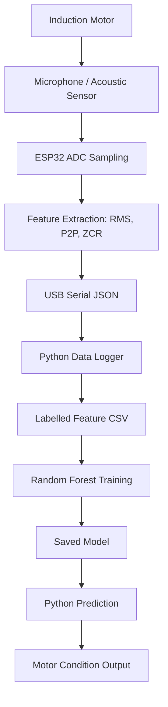

# System Architecture



## Interface contract
Example serial message:

```json
{"samples":4000,"rms":42.1234,"peak_to_peak":350,"zero_crossing_rate":0.102000}
```

The numeric values above are illustrative only.
